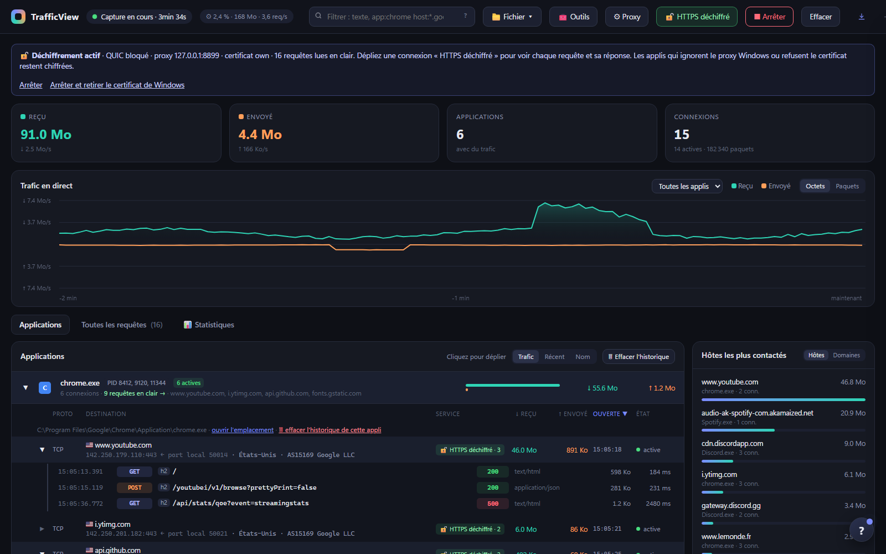
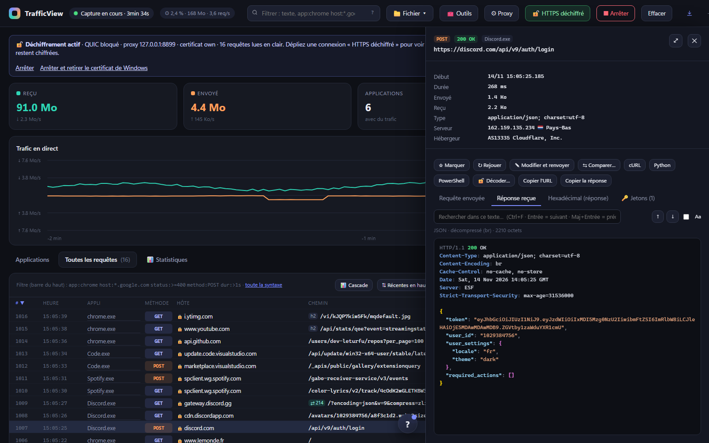
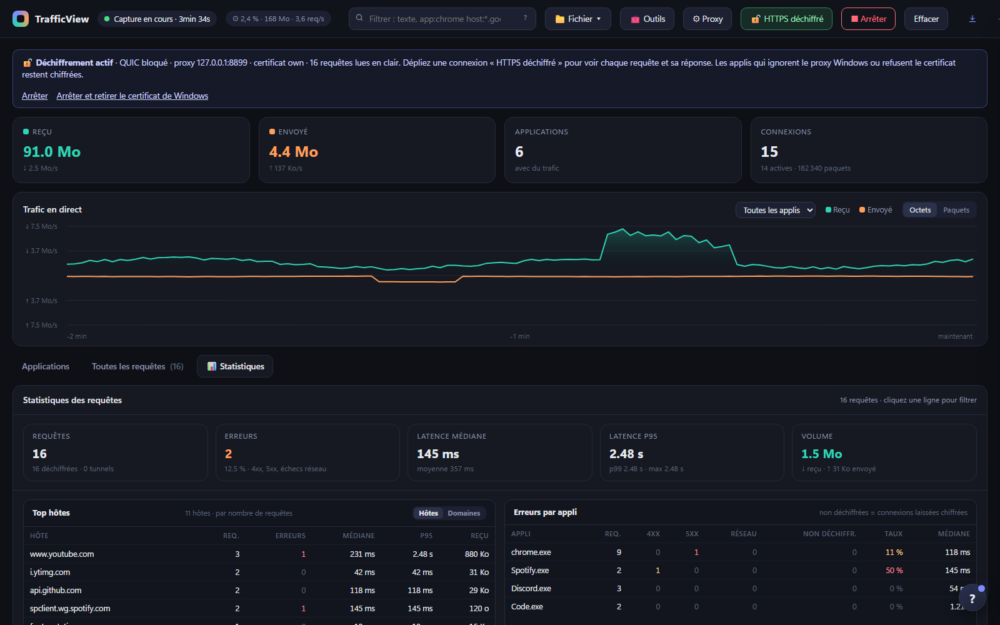

# TrafficView

**Voyez en direct ce que chaque application de Windows envoie et reçoit sur Internet, y compris le contenu des requêtes HTTPS.**

TrafficView capture le trafic réseau de votre PC, le range par application (Chrome, Discord, Spotify, un jeu, un émulateur…) et, d'un clic, déchiffre le HTTPS pour afficher chaque requête et sa réponse en clair : en-têtes, corps JSON indenté, images, messages WebSocket. Un seul `.exe`, rien à installer.



## Télécharger

➡️ **[TrafficView.exe](../../releases/latest)** (Windows 10/11 64 bits)

Lancez l'exe : Windows demande l'autorisation administrateur (obligatoire pour capturer les paquets). .NET est inclus dans l'exe ; seul WebView2 est nécessaire, et il est déjà présent sur Windows 10/11.

## Fonctionnalités

### Voir qui parle à qui
- **Trafic par application** : débit reçu / envoyé, connexions IPv4 et IPv6, hôtes contactés, pays et hébergeur du serveur (drapeau, ASN).
- **Graphique en direct** des 2 dernières minutes, pour toutes les applis ou une seule.
- **Hôtes les plus contactés**, regroupables par domaine (`google.com` au lieu de 20 sous-domaines).
- Capture sans pilote (socket *raw* Windows), attribution de chaque connexion à son processus.

### Lire le HTTPS en clair
- **🔒 Déchiffrer HTTPS** en un clic : certificat racine local + proxy (comme Fiddler ou mitmproxy), retiré proprement à l'arrêt.
- **HTTP/2**, **WebSocket**, **gRPC / Protobuf** (décodé sans fichier `.proto`), **JWT** décodés avec leur date d'expiration.
- QUIC / HTTP/3 bloqué pendant le déchiffrement pour que Chrome et Edge repassent par le proxy.
- Les applis qui épinglent leur certificat sont détectées et laissées tranquilles, pour ne rien casser.



### Chercher, comprendre, mesurer
- **Filtres avancés** : `app:chrome host:*.google.com status:>=400 method:POST dur:>1s body:token`… (raccourcis mitmproxy acceptés).
- **Statistiques** : taux d'erreurs, latences médiane / p95 / p99, top hôtes, erreurs par appli, requêtes les plus lentes.
- **Vue en cascade** : chaque requête sur un axe du temps.
- Recherche dans les corps, vue hexadécimale, comparaison de deux requêtes côte à côte.



### Modifier et tester
- **Rejouer**, **modifier et renvoyer** une requête ; copier en **cURL**, **Python** ou **PowerShell**.
- **Règles** : bloquer un hôte, répondre avec un fichier local, ajouter / retirer un en-tête, remplacer du texte, rediriger vers un autre serveur (`localhost:3000`…).
- **Points d'arrêt** : mettre une requête ou une réponse en pause pour la modifier avant qu'elle reparte.
- **Réseau simulé** par appli : latence, débit limité (4G, 3G, Wi-Fi faible) ou coupure.
- **Relancer une appli à travers TrafficView** quand elle ignore le proxy Windows (Python, Node, Go, curl, .NET).

### Émulateurs et téléphones
- Remplace `mitmweb` : proxy HTTP + SOCKS5 sur le port de votre choix, réutilisation du certificat mitmproxy.
- **Assistant BlueStacks 5 / MSI App Player** : installation du certificat dans les certificats système Android, root, proxy de l'instance en un clic.
- Téléphone sur le même Wi-Fi : proxy `IP-du-PC:8899` + certificat à télécharger sur `http://IP-du-PC:8899/cert`.

### Enregistrer et exporter
- Sessions `.tvsession` à rouvrir sur n'importe quel PC, enregistrement automatique.
- Export **HAR** (Chrome DevTools, Charles, Fiddler, Postman) et **PCAP** (Wireshark, requêtes déchiffrées incluses).
- **Alertes** : nouveau domaine contacté, débit anormal, pic d'erreurs.

### Aide intégrée
55 tutos pas à pas dans l'appli (bulle **?** ou **F1**), avec une recherche en langage courant (« bloquer la pub », « pourquoi non déchiffré »).

## Prérequis

- Windows 10 ou 11, 64 bits
- Droits administrateur (capture des paquets)
- WebView2 Runtime (déjà installé sur Windows 10/11 à jour)

## Bon à savoir

- Le trafic local `127.0.0.1` n'est pas capturé (il ne passe par aucune carte réseau).
- Si aucun paquet entrant n'apparaît, autorisez TrafficView dans le pare-feu Windows :
  ```powershell
  New-NetFirewallRule -DisplayName "TrafficView" -Direction Inbound -Program "<chemin>\TrafficView.exe" -Action Allow
  ```
- ⚠️ Tant que le certificat **TrafficView Root CA** est installé, votre PC fait confiance aux certificats qu'il signe. Retirez-le quand vous n'en avez plus besoin (lien *Arrêter et retirer le certificat de Windows*).
- N'analysez que le trafic de vos propres appareils et applications.

## Licence

TrafficView est distribué sous **GNU General Public License version 3** (voir [LICENSE](LICENSE) et [NOTICE.md](NOTICE.md)).

## Composants tiers

- **BlueStacks Root GUI** v3.12.1, © Rob Adams Jr ([RobThePCGuy/BlueStacks-Root-GUI](https://github.com/RobThePCGuy/BlueStacks-Root-GUI)), GPL-3.0 : logique de rootage réécrite en C#. Son code source d'origine et sa licence sont inclus dans l'application (⚙ Proxy → 📱 Assistant BlueStacks → *Licence et code source*).
- **IP Geolocation by [DB-IP](https://db-ip.com)** : bases *DB-IP Lite* pays et ASN, licence CC BY 4.0.
- **Twemoji** (drapeaux des pays), © Twitter, licence CC BY 4.0.

---

© 2026 [LeTurfu](https://www.leturfu.com/)
